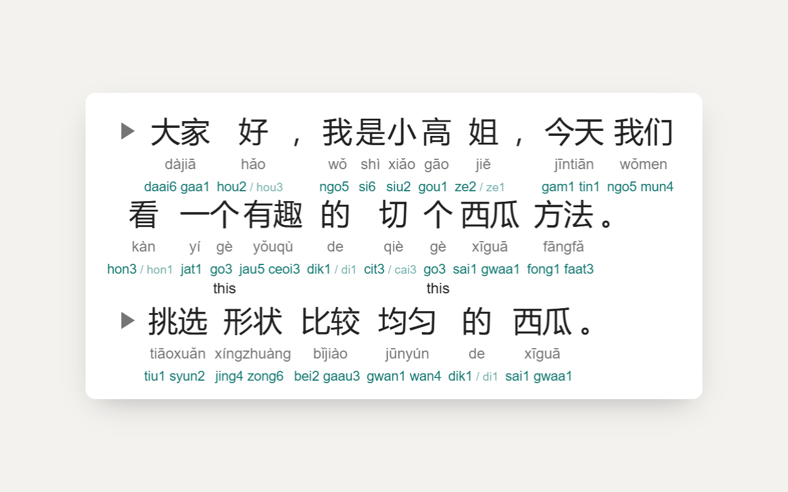

# Jyutping & Pinyin

Adds the Cantonese reading (jyutping) under Mandarin pinyin on any web page, and the
pinyin under jyutping. Made for learning Cantonese from Mandarin resources.

## Install

Firefox: [Firefox Add-ons](https://addons.mozilla.org/firefox/search/?q=Jyutping%20%26%20Pinyin).
Chrome and Edge versions aren't in their stores yet.

## Usage

Pages that show pinyin or jyutping get the other reading added automatically.

The 粵 toolbar panel lets you:

- show pinyin, jyutping, both, or neither (turning one off replaces it with the other)
- choose the tone style, position, size and colour of the added reading
- turn the extension off for the current site

On the page:

- **Click** a reading to hear it, using your browser's voices
- **Shift+click** a jyutping reading to correct it
- **Alt+J** / **Alt+P** turn jyutping / pinyin on and off

## How readings are chosen

The pinyin on the page decides the Cantonese reading, since many characters have more
than one: 行 xíng → hang4, but 行 háng → hong4; 長 cháng → coeng4, but 長 zhǎng → zoeng2.

## Credits

Readings come from [CC-Canto](https://cantonese.org) and the CC-CEDICT Cantonese readings
by Pleco Inc., licensed CC BY-SA 3.0.

## License

MIT for the code. The dictionary data in `extension/data/canto.txt` is CC BY-SA 3.0.
